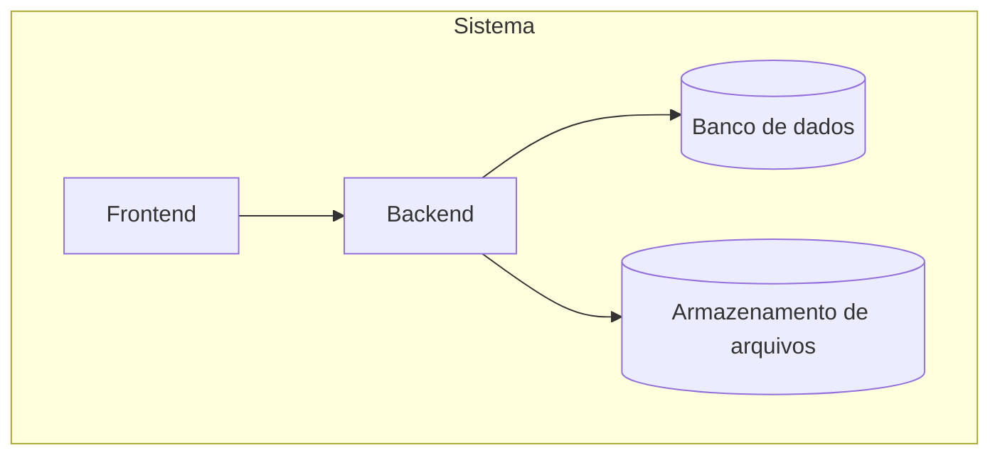
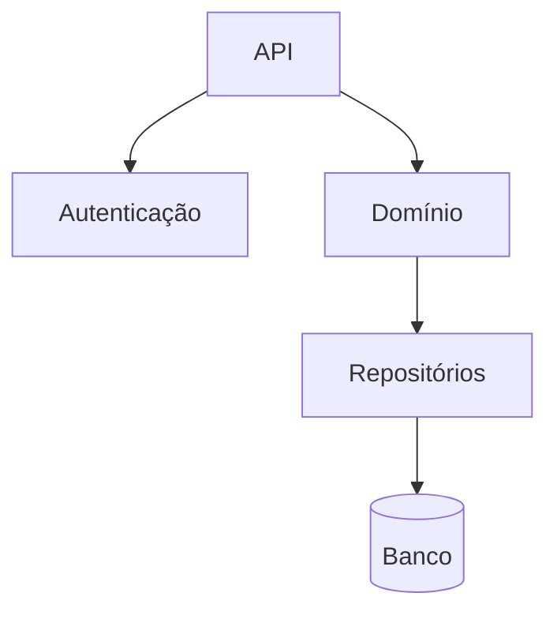
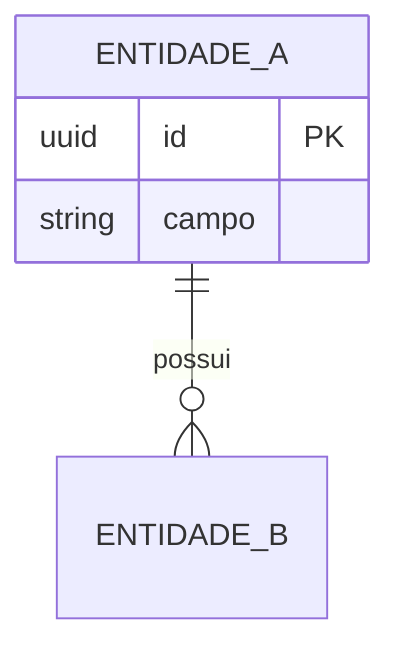
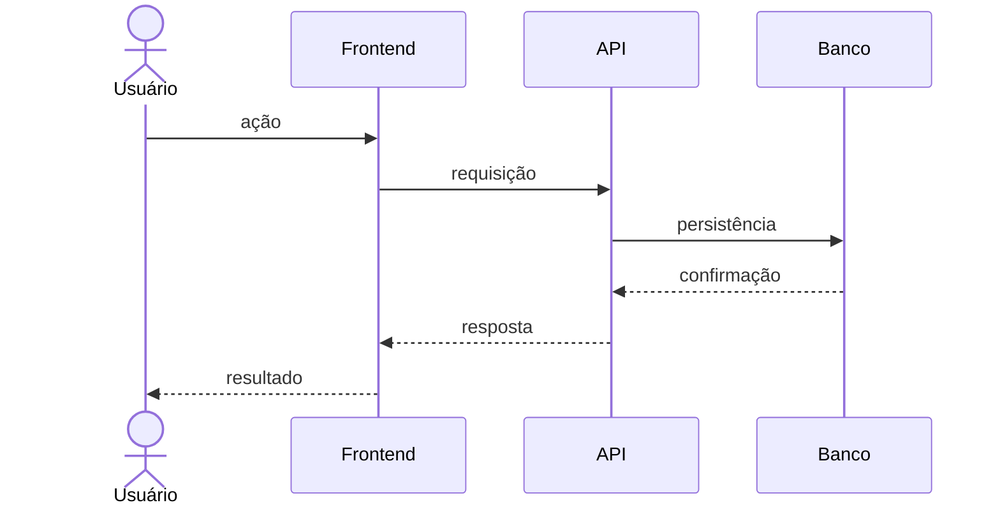
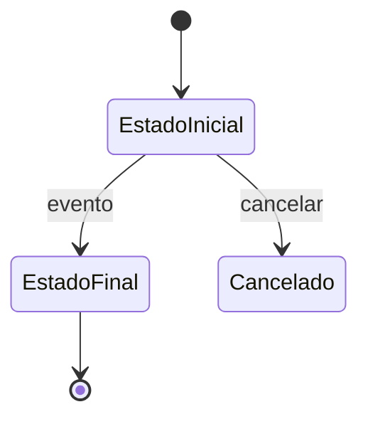

# Template de TDD (Documento Técnico de Design)

> **Como usar:** este é o esqueleto obrigatório do documento. Substitua todo texto entre `<...>` pelo conteúdo real. Remova as citações de orientação (`>`) antes de salvar. Não deixe placeholders vazios: use `Não aplicável` com justificativa ou registre uma pergunta em aberto.
>
> **TDD = Technical Design Document.** Não confundir com Test-Driven Development. Os trechos de código, payloads e DDL são ilustrativos; o documento não implementa a solução.

---

# <Nome do Sistema ou Iniciativa> — TDD

> **Versão:** <0.1> · **Status:** <Rascunho | Em revisão | Aprovado> · **Data:** <AAAA-MM-DD>
> **Autor:** <nome> · **Revisores/Stakeholders:** <nomes e papéis>
> **PRD de referência:** <caminho ou "Não aplicável">
> **Recorte:** <o que este TDD cobre do PRD ou do sistema>
> **Histórico de versões:** <0.1 — criação; 0.2 — ...>

## 1. Resumo executivo técnico

<3 a 5 parágrafos curtos: qual problema técnico existe, qual solução arquitetural é proposta, quais componentes são afetados, quais decisões principais foram tomadas e qual é o recorte. Deve ser compreensível por engenharia, produto e operação.>

## 2. Contexto e objetivos técnicos

### 2.1 Contexto

<Como o sistema funciona hoje, quais componentes existem, quais são os pontos de extensão e o que motivou este design. Cite evidências: código, PRD, documentos, configuração.>

### 2.2 Objetivos técnicos

| ID | Objetivo | Como será verificado |
| --- | --- | --- |
| OBJ-001 | <objetivo técnico mensurável> | <teste, métrica, revisão> |

### 2.3 Requisitos de origem

<Requisitos do PRD ou do sistema que este TDD precisa atender. Use `PRD:RF-001` para evitar colisão de IDs.>

| ID de origem | Requisito | Como o TDD endereça | Componente |
| --- | --- | --- | --- |
| PRD:RF-001 | <título do requisito> | <decisão, contrato, fluxo ou componente> | C-001 |

### 2.4 Fora do escopo técnico

- <o que este design deliberadamente não cobre e onde será tratado>

## 3. Restrições, premissas e dependências

### 3.1 Restrições

| ID | Restrição | Origem | Consequência no design |
| --- | --- | --- | --- |
| RT-001 | <stack, infraestrutura, prazo, equipe, contrato, compliance> | <PRD, README, contrato> | <impacto> |

### 3.2 Premissas técnicas

| ID | Premissa | Origem | Impacto se falsa | Confirmada? |
| --- | --- | --- | --- | --- |
| PT-001 | <premissa adotada> | <AMB-001> | <consequência técnica> | <sim/não — data> |

### 3.3 Dependências

- <time, serviço, aprovação, biblioteca, ambiente ou entrega externa necessária>

## 4. Visão geral da arquitetura

### 4.1 Estilo arquitetural

<Descreva o estilo escolhido e a justificativa. Referencie a decisão correspondente.>

- **Estilo:** <monólito modular | camadas | microserviços | serverless | evento-driven | outro>
- **Justificativa:** <por que este estilo atende ao recorte e às restrições>
- **Decisão:** <DEC-001>

### 4.2 Contexto (C4 nível 1)

<Quem usa o sistema, quais sistemas externos existem e quais são as fronteiras.>


### 4.3 Containers (C4 nível 2)

<Aplicações, serviços, bancos, filas, armazenamento e suas relações.>



### 4.4 Componentes (C4 nível 3)

<Componentes internos relevantes, quando o detalhamento agregar valor.>



### 4.5 Fluxo de dados

<Como os dados entram, trafegam, são persistidos e saem. Destaque dados sensíveis, volumes e retenção.>

## 5. Componentes e responsabilidades

| ID | Componente | Responsabilidade | Tecnologia | Interfaces | Dono |
| --- | --- | --- | --- | --- | --- |
| C-001 | <nome> | <o que faz e o que não faz> | <stack> | <API, fila, banco> | <time> |

### 5.1 Fronteiras e dependências permitidas

- **Permitido:** <C-001 → C-002 via API interna>
- **Proibido:** <acesso direto ao banco de outro componente>

## 6. Modelo de dados

### 6.1 Entidades e relacionamentos



### 6.2 Esquema lógico

<Esquema em nível lógico. Tipos, restrições, índices e justificativa para campos sensíveis ou de alto volume.>

| Tabela | Coluna | Tipo | Restrições | Índices | Observações |
| --- | --- | --- | --- | --- | --- |
| <tabela> | <coluna> | <tipo> | <PK/FK/NOT NULL/UNIQUE/CHECK> | <índice> | <retenção, criptografia, origem> |

### 6.3 Migrações e versionamento

- **Ferramenta:** <EF Core Migrations, Flyway, Liquibase, outra>
- **Estratégia:** <forward-only, expand/contract, janela de manutenção>
- **Compatibilidade:** <como o código antigo e o novo convivem durante o deploy>
- **Reversão:** <como desfazer uma migration problemática>

### 6.4 Retenção, expurgo e arquivamento

| Dado | Prazo | Ação após o prazo | Base |
| --- | --- | --- | --- |
| <dado pessoal, foto, registro financeiro> | <prazo> | <excluir, anonimizar, arquivar> | <LGPD, fiscal, contratual> |

### 6.5 Consistência e concorrência

- **Transações:** <fronteiras e nível de isolamento>
- **Concorrência:** <lock otimista/pessimista, versão, idempotência>
- **Consistência eventual:** <onde é aceitável e como o usuário percebe>

## 7. Contratos de API

### 7.1 Princípios

- **Estilo:** <REST | GraphQL | gRPC | outro> — decisão <DEC-002>
- **Versionamento:** <estratégia>
- **Formato:** <JSON, datas em ISO 8601, valores monetários>
- **Autenticação:** <mecanismo>
- **Idempotência:** <chave, escopo e retenção>
- **Paginação e filtros:** <padrão>
- **Limites:** <rate limit, timeout, tamanho máximo>

### 7.2 Endpoints

| ID | Método | Rota | Objetivo | Permissão | Requisito | Idempotente |
| --- | --- | --- | --- | --- | --- | --- |
| API-001 | POST | /recurso | <ação> | <perfil> | PRD:RF-001 | <sim/não> |

### 7.3 Exemplos de requisição e resposta

<Exemplos ilustrativos. Não implementar.>

```http
POST /recurso
Content-Type: application/json

{
  "campo": "valor"
}
```

```json
{
  "id": "uuid",
  "status": "criado"
}
```

### 7.4 Modelo de erros

| Código HTTP | Código interno | Quando ocorre | Mensagem ao cliente | Ação esperada |
| --- | --- | --- | --- | --- |
| 400 | VALIDATION_ERROR | <validação> | <mensagem> | <corrigir entrada> |
| 401 | UNAUTHENTICATED | <sessão inválida> | <mensagem> | <autenticar> |
| 403 | FORBIDDEN | <sem permissão> | <mensagem> | <solicitar acesso> |
| 409 | CONFLICT | <duplicidade/concorrência> | <mensagem> | <recarregar> |
| 422 | BUSINESS_RULE | <regra de negócio> | <mensagem> | <ajustar> |
| 500 | INTERNAL_ERROR | <falha inesperada> | <mensagem genérica> | <acionar suporte> |

### 7.5 Autenticação e autorização

- **Autenticação:** <provedor, fluxo, expiração, refresh>
- **Autorização:** <RBAC/ABAC, matriz de permissões, escopo>
- **Sessão:** <cookie, token, storage, logout>
- **Segredos:** <gestão e rotação>

### 7.6 Paginação, filtros e ordenação

<Padrão único para todas as listas, com limites máximos e comportamento em resultados vazios.>

### 7.7 Versionamento e compatibilidade

<Como mudanças incompatíveis são tratadas e por quanto tempo versões antigas são suportadas.>

### 7.8 Limites e proteção

<Rate limiting, quotas, tamanho de payload, timeout e circuit breaker.>

## 8. Fluxos e sequências

### 8.1 Fluxos principais

<Um diagrama por fluxo relevante.>



### 8.2 Fluxos alternativos e de erro

| Situação | Comportamento | Estado final | Observabilidade |
| --- | --- | --- | --- |
| <validação falha> | <resposta e mensagem> | <nada persistido> | <log/métrica> |
| <duplicidade> | <resposta> | <registro existente> | <log> |
| <timeout de dependência> | <retry, fallback ou erro> | <consistente> | <alerta> |
| <concorrência> | <lock ou versão> | <sem perda> | <métrica> |
| <indisponibilidade> | <degradação ou contingência> | <recuperável> | <alerta> |

### 8.3 Máquinas de estado



## 9. Aspectos transversais

### 9.1 Segurança

- **Autenticação e sessão:** <mecanismo>
- **Autorização:** <modelo e pontos de verificação>
- **Proteção de dados:** <TLS, criptografia em repouso, mascaramento>
- **Validação de entrada:** <onde e como>
- **Dependências:** <política de atualização e varredura>
- **Ameaças consideradas:** <STRIDE, OWASP, abuso de fluxo>

### 9.2 Privacidade e LGPD

- **Dados pessoais tratados:** <quais>
- **Base legal:** <qual ou "a definir">
- **Minimização:** <o que não é coletado>
- **Retenção e expurgo:** <prazo e mecanismo>
- **Direitos do titular:** <acesso, correção, exportação, anonimização>
- **Acesso:** <quem vê o quê e como é auditado>

### 9.3 Observabilidade

| Sinal | O que registrar | Retenção | Alerta |
| --- | --- | --- | --- |
| Logs | <eventos, correlação, nível> | <prazo> | <condição> |
| Métricas | <latência, erro, volume> | <prazo> | <limiar> |
| Traces | <fluxos críticos> | <prazo> | <condição> |
| Auditoria | <ações críticas> | <prazo> | <condição> |

- **Correlação:** <request id, trace id, usuário>
- **Dados sensíveis em log:** <o que nunca é registrado>

### 9.4 Desempenho e escalabilidade

| Cenário | Volume | Meta | Como verificar |
| --- | --- | --- | --- |
| <consulta crítica> | <req/s ou volume> | <p95, p99> | <teste de carga> |
| <operação em lote> | <volume> | <tempo> | <benchmark> |

- **Gargalos conhecidos:** <quais>
- **Estratégia de escala:** <vertical, horizontal, cache, fila>
- **Limites:** <quota, pool de conexões, timeout>

### 9.5 Resiliência e tratamento de erros

- **Política de retry:** <quando, quantas vezes, backoff>
- **Timeout:** <por dependência>
- **Circuit breaker:** <quando abre e como fecha>
- **Degradação:** <o que continua funcionando>
- **Mensagens ao usuário:** <padrão>

### 9.6 Concorrência e integridade

- **Operações críticas:** <quais>
- **Controle:** <lock, versão, restrição única>
- **Idempotência:** <onde e por quanto tempo>
- **Consistência:** <forte ou eventual, por operação>

### 9.7 Configuração e feature flags

| Configuração | Onde vive | Padrão | Quem altera | Efeito |
| --- | --- | --- | --- | --- |
| <chave> | <appsettings, banco, secret> | <valor> | <perfil> | <comportamento> |

### 9.8 Localização e acessibilidade

- **Idioma:** <pt-BR ou outro>
- **Fuso e moeda:** <America/Sao_Paulo, BRL>
- **Acessibilidade:** <WCAG 2.2 AA, navegação por teclado, leitor de tela>
- **Formatos:** <datas, números, moeda>

### 9.9 Auditoria

<Quais ações são auditadas, o que é registrado, como é protegido e como é consultado. Referencie o requisito do PRD.>

## 10. Estratégia de testes

### 10.1 Pirâmide e escopo

| Nível | Objetivo | Ferramenta | Escopo |
| --- | --- | --- | --- |
| Unitário | <regras e cálculos> | <framework> | <componentes> |
| Integração | <banco, fila, storage> | <framework> | <fronteiras> |
| Contrato | <API e consumidores> | <ferramenta> | <endpoints> |
| E2E | <jornadas críticas> | <ferramenta> | <fluxos> |
| Não funcional | <carga, segurança, acessibilidade> | <ferramenta> | <cenários> |

### 10.2 Matriz por componente

| Componente | Unitário | Integração | Contrato | E2E |
| --- | --- | --- | --- | --- |
| C-001 | <o que cobrir> | <o que cobrir> | <o que cobrir> | <o que cobrir> |

### 10.3 Dados e isolamento

<Como os testes criam, isolam e limpam dados. Como evitar dependência de produção.>

### 10.4 Metas de cobertura

| Escopo | Meta | Justificativa |
| --- | --- | --- |
| <domínio> | <%> | <risco> |

> Se a meta não foi acordada, escreva "a definir" e registre em `Q-xxx`. Não invente percentuais.

### 10.5 Testes não funcionais

- **Carga:** <cenário, volume, critério>
- **Segurança:** <análise, varredura, teste de autorização>
- **Acessibilidade:** <ferramenta e critério>
- **Resiliência:** <falha injetada e comportamento esperado>

## 11. Implantação e operação

### 11.1 Ambientes

| Ambiente | Propósito | Dados | Acesso |
| --- | --- | --- | --- |
| Desenvolvimento | <propósito> | <sintéticos> | <quem> |
| Homologação | <propósito> | <mascarados> | <quem> |
| Produção | <propósito> | <reais> | <quem> |

### 11.2 Pipeline CI/CD

| Etapa | O que executa | Critério para avançar |
| --- | --- | --- |
| Build | <compilação> | <sem erro> |
| Testes | <unit, integração> | <aprovados> |
| Análise | <lint, segurança> | <sem bloqueio> |
| Deploy | <ambiente> | <aprovação> |

### 11.3 Infraestrutura

<Hospedagem, containers, banco, storage, rede e requisitos de capacidade. Sem prescrever fornecedor sem decisão registrada.>

### 11.4 Configuração e segredos

<Como configurações e segredos são injetados, versionados e rotacionados. O que nunca entra no repositório.>

### 11.5 Observabilidade operacional

<Painéis, alertas, runbooks e responsáveis. Referencie a seção 9.3.>

### 11.6 Backup e recuperação

| Item | Frequência | Retenção | RPO | RTO | Teste |
| --- | --- | --- | --- | --- | --- |
| <banco, arquivos> | <frequência> | <prazo> | <tempo> | <tempo> | <frequência> |

### 11.7 Rollout, migração e rollback

1. <pré-condições>
2. <ordem de deploy>
3. <migração de dados>
4. <verificação>
5. <rollback e critério de acionamento>

## 12. Decisões técnicas (ADR)

> **Fonte única da verdade.** Toda escolha técnica material do documento deve aparecer aqui. O texto das outras seções referencia o `DEC` correspondente e não o contradiz.

### 12.1 Índice de decisões

| ID | Título | Status | Data | Substitui | Requisitos |
| --- | --- | --- | --- | --- | --- |
| DEC-001 | <título> | <Proposta/Aceita/Substituída/Rejeitada> | <data> | <DEC-xxx ou —> | <PRD:RF-001> |

Status permitidos:

- **Proposta:** decisão tomada pelo agente ou assumida, ainda pendente de confirmação humana.
- **Aceita:** decisão confirmada pelo usuário ou por autoridade competente.
- **Substituída:** decisão histórica trocada por outra; manter o registro e apontar a substituta.
- **Rejeitada:** alternativa avaliada e descartada; manter o motivo.

### 12.2 Detalhamento

#### DEC-001 — <título>

- **Status:** <Proposta | Aceita | Substituída | Rejeitada>
- **Data:** <AAAA-MM-DD>
- **Dono:** <nome ou "a definir">
- **Contexto:** <forças, restrições e problema que exigem a decisão>
- **Decisão:** <o que foi decidido, em uma frase objetiva>
- **Alternativas consideradas:**
  - <alternativa 1> — <prós, contras e motivo do descarte>
  - <alternativa 2> — <prós, contras e motivo do descarte>
- **Justificativa:** <por que esta opção venceu>
- **Consequências:** <impactos positivos, negativos, custos e dívidas assumidas>
- **Requisitos impactados:** <PRD:RF-001, RNF-001>
- **Riscos associados:** <R-001>
- **Substitui / é substituída por:** <DEC-xxx ou "—">

<Repita o bloco para cada decisão material.>

## 13. Riscos técnicos e trade-offs

| ID | Risco | Probabilidade | Impacto | Mitigação | Dono | Decisão relacionada |
| --- | --- | --- | --- | --- | --- | --- |
| R-001 | <risco técnico> | <alta/média/baixa> | <alto/médio/baixo> | <ação> | <nome ou "a definir"> | DEC-001 |

### 13.1 Trade-offs aceitos

| Trade-off | O que se ganha | O que se abre mão | Quando revisar |
| --- | --- | --- | --- |
| <escolha> | <benefício> | <custo> | <gatilho> |

## 14. Plano de implementação

### 14.1 Fases e marcos

| Fase | Escopo técnico | Dependências | Critério de conclusão |
| --- | --- | --- | --- |
| F1 | <componentes e contratos> | <DEC aceitas> | <testes e revisão> |
| F2 | <evolução> | <F1> | <critério> |

### 14.2 Ordem de implementação

1. <fundação: dados, autenticação, esqueleto>
2. <domínio e contratos>
3. <integrações e fluxos>
4. <observabilidade e operação>
5. <endurecimento e testes não funcionais>

### 14.3 Definition of Done técnico

- [ ] Decisões `DEC` do escopo estão `Aceitas`.
- [ ] Contratos de API revisados e versionados.
- [ ] Migrations testadas em base limpa e em base com dados.
- [ ] Testes unitários, de integração e de contrato verdes.
- [ ] Cenários de erro e concorrência cobertos.
- [ ] Observabilidade e alertas configurados.
- [ ] Backup, restauração e rollback testados.
- [ ] Segurança e privacidade revisadas.
- [ ] Documentação e runbook atualizados.

## 15. Perguntas em aberto

| ID | Pergunta | Por que importa | Dono | Prazo |
| --- | --- | --- | --- | --- |
| Q-001 | <pergunta> | <impacto técnico> | <nome ou "a definir"> | <data ou "a definir"> |

## 16. Aprovações

| Papel | Nome | Status | Data |
| --- | --- | --- | --- |
| Tech Lead | <nome> | <pendente/aprovado> | <data> |
| Arquiteto(a) | <nome> | <pendente/aprovado> | <data> |
| Segurança | <nome> | <pendente/aprovado> | <data> |
| Product Owner | <nome> | <pendente/aprovado> | <data> |
| Operações | <nome> | <pendente/aprovado> | <data> |

## Apêndices

### A. Glossário técnico

| Termo | Definição |
| --- | --- |
| <termo> | <definição> |

### B. Referências

- <PRD, código, documento, ADR externo, padrão>

### C. Matriz de rastreabilidade

| Requisito de origem | Componente | API/Dado | Teste | Decisão |
| --- | --- | --- | --- | --- |
| PRD:RF-001 | C-001 | API-001 / E-001 | <teste> | DEC-001 |

### D. Registro de ambiguidades

| ID | Tipo | Impacto | Origem | Ação | Pergunta feita | Resposta/Decisão | Status |
| --- | --- | --- | --- | --- | --- | --- | --- |
| AMB-001 | <Arquitetura/Modelo de dados/Contrato de API/Integração/Segurança/Privacidade/Desempenho/Operação/Observabilidade/Testes/Tecnologia/Escopo técnico/Termo> | <Bloqueante/Alto/Médio/Baixo> | <Prompt/PRD/Documento/Código/Inferência> | <Perguntar/Decidir/Registrar em aberto> | <pergunta> | <resposta ou decisão> | <Resolvida/Decisão confirmada/Em aberto> |

> Nenhuma ambiguidade com impacto **Bloqueante** pode permanecer `Em aberto` na versão final.

### E. Checklist de prontidão técnica

- [ ] Arquitetura e fronteiras estão claras e justificadas.
- [ ] Componentes têm responsabilidade e dono.
- [ ] Modelo de dados cobre restrições, índices, migração e retenção.
- [ ] Contratos de API cobrem sucesso, erro, permissão e idempotência.
- [ ] Fluxos principais e de erro estão descritos.
- [ ] Segurança, privacidade, observabilidade e operação estão tratadas.
- [ ] Estratégia de testes cobre domínio, integração e não funcionais.
- [ ] Decisões materiais estão no registro ADR e coerentes com o texto.
- [ ] Riscos e trade-offs têm mitigação e dono.
- [ ] Nenhuma decisão Bloqueante está provisória sem confirmação.
