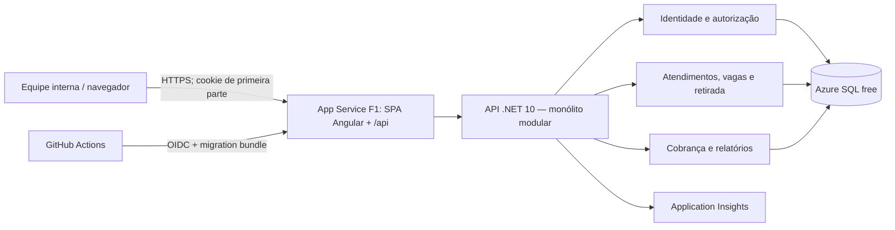
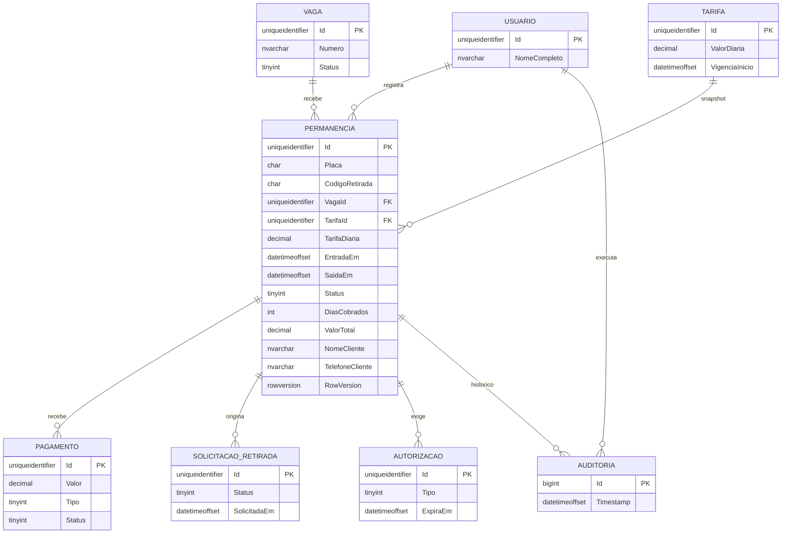
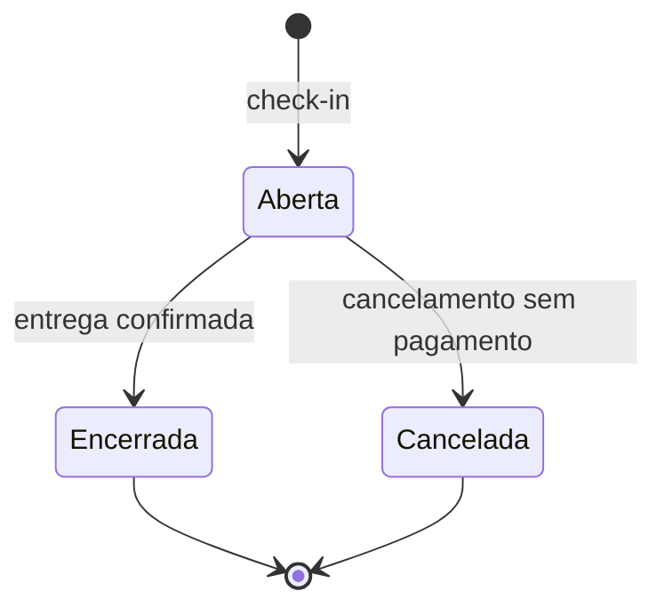
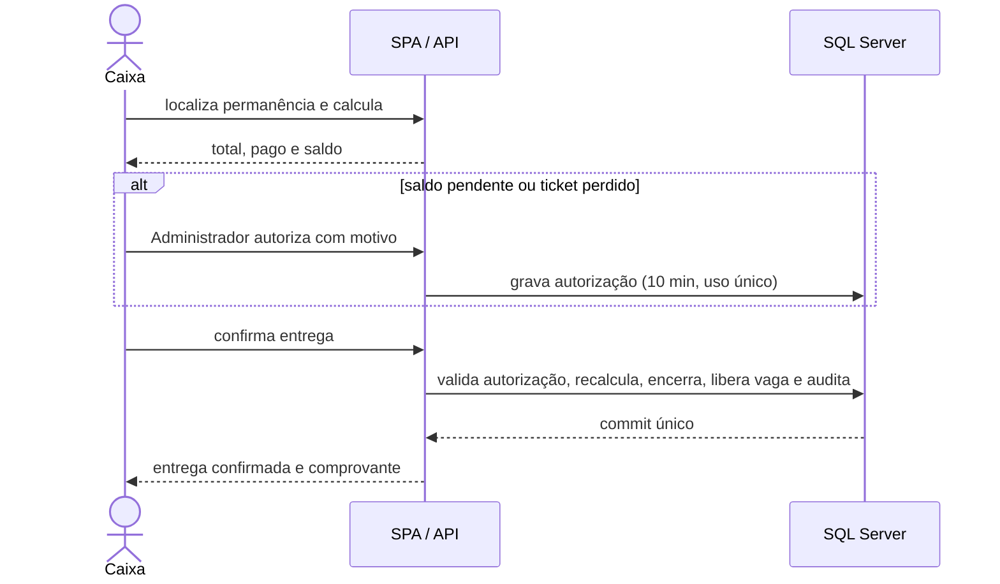

# TDD — Plataforma de Gestão de Estacionamento e Valet

**Status:** Aprovado para orientar o desenvolvimento do MVP; aprovações formais e condições de produção pendentes
**Data:** 05/11/2026
**Aprovação:** solicitante, em 05/11/2026. A aprovação do design não dispensa os bloqueios de produção e as validações indicados neste documento e no PRD.
**Escopo:** MVP de uma unidade; documento de design técnico, não plano de test-driven development.
**Decisor técnico:** solicitante (decisões registradas na entrevista desta conversa); responsáveis por operação, privacidade e negócio ainda não designados.
**Fontes:** [`docs/prd/plataforma-gestao-estacionamento-valet.md`](../prd/plataforma-gestao-estacionamento-valet.md), aprovado para planejamento; `docs/entrevista.md`, entrevista fictícia; `README.md`, contexto e stack sinalizada.
**Divergência registrada:** as fotos de condição foram removidas do MVP por decisão do solicitante (DT-09). Isso reduz o RF-005 e exige atualização da RN-019 no PRD; nenhuma outra regra aprovada foi alterada.

## 1. Resumo, objetivos e limites

Digitalizar entrada, ocupação de vaga, busca, retirada, cálculo, registro manual de pagamento, entrega e histórico auditável. Priorizar invariantes transacionais (RF-004, RF-016, RF-017; RNF-011), autorização no servidor (RF-002; RNF-003), proteção de dados pessoais (RNF-004), rastreabilidade (RF-024) e disponibilidade compatível com o piloto (RNF-002). Relatórios (RF-019 a RF-023) são P1 e não podem comprometer as operações de balcão.

Sem gateway de pagamento, fotos, múltiplas unidades, emissão fiscal, app de cliente ou modo offline no MVP. Tarifa inicial, horário de funcionamento, volume real, SLA contratado e prazo fiscal de retenção **não são fatos conhecidos**: são condições de implantação, não valores arbitrados neste documento.

A arquitetura é um **monólito modular .NET 10** com SPA Angular 22 servida na mesma origem, em **App Service F1 + Azure SQL free offer**, sem Docker. O objetivo é custo zero no piloto, com limites e riscos explícitos. A operação precisa aceitar que o free tier não garante 99,5% de disponibilidade nem suporta 500 check-ins/dia com folga.

## 2. Registro central de decisões

**Origem:** “solicitante/inicial” = pedido desta conversa; “solicitante/entrevista” = respostas às perguntas técnicas; “PRD” = requisito aprovado; “TDD” = decisão derivada para cumprir o PRD. Versões não confirmadas serão fixadas e verificadas no início da implementação, sem inferir aprovação dos badges do README.

| ID | Tema | Decisão e estado | Origem/decisor | Justificativa, alternativas e consequências |
| --- | --- | --- | --- | --- |
| DT-01 | Frontend | **Confirmada:** Angular 22, TypeScript, componentes standalone, Zoneless e Signals; Signal Forms quando compatível com a versão fixada. | Solicitante/inicial e entrevista | Estado reativo sem ZoneJS; alternativa Reactive Forms. Validar dependências e testes com Angular 22; validação autoritativa permanece no servidor. |
| DT-02 | UI | **Confirmada:** Tailwind CSS, Angular CDK e Lucide Icons; sem Angular Material no MVP. | Solicitante/entrevista | Controle visual e menos dependência de tema; exige cuidado explícito com teclado, foco, contraste e rótulos. |
| DT-03 | Backend | **Confirmada:** C#/.NET 10, ASP.NET Core Web API com controllers, solução `.slnx`, Clean Architecture e DDD pragmático. | Solicitante/inicial e entrevista | Casos de uso independentes de HTTP e EF; alternativa Minimal APIs. Evitar agregados artificiais e abstrações genéricas. |
| DT-04 | Topologia | **Confirmada:** monólito modular, uma API, módulos Identidade, Operação, Financeiro, Relatórios e Auditoria. | Solicitante/entrevista | Uma transação relacional para invariantes; alternativa microsserviços exigiria coordenação distribuída. Módulos não são deploys separados. |
| DT-05 | Persistência | **Confirmada:** SQL Server com EF Core, migrações versionadas e banco alvo Azure SQL. | Solicitante/entrevista | Integridade e consultas transacionais; alternativa PostgreSQL. Fixar provider compatível com .NET 10. |
| DT-06 | Autenticação | **Confirmada:** ASP.NET Core Identity, sessão em cookie HttpOnly de primeira parte, antiforgery e papéis Administrador, Manobrista e Caixa. | Solicitante/entrevista; RF-001, RF-002 | Alternativas OIDC/tokens. Provisionamento administrativo, sem autorregistro; autorização por operação e projeção de leitura. |
| DT-07 | Hospedagem | **Confirmada:** App Service F1 servindo SPA e API na mesma origem; Azure SQL free offer; sem Docker, Blob, Redis, Key Vault ou staging. | Solicitante/entrevista | Custo zero e menos operação; alternativa Docker em VM foi descartada. Consequências: CPU limitada, sem Always On, sem slot e sem SLA. |
| DT-08 | Atualização | **Confirmada:** polling de 5 s no painel, refetch após comando e pausa em aba oculta; sem SignalR. | Solicitante/entrevista; RF-008 | Menos infraestrutura; a tela nunca é fonte de verdade. Medir intervalo e carga no piloto. |
| DT-09 | Dados sensíveis | **Confirmada:** sem fotos; observação textual de condição; nome e telefone opcionais; anonimização após 12 meses; TDE e mascaramento em logs. | Solicitante/entrevista; RF-005, RF-025, RNF-004 | Remove tratamento de imagem e storage. Consequência: evidência de danos mais fraca e PRD a atualizar. |
| DT-10 | Testes | **Confirmada:** MSTest para unidade/integração, SQL Server real nos testes de integração, Vitest e Playwright. | Solicitante/inicial e entrevista | SQLite/InMemory não reproduzem índices filtrados e `rowversion`; E2E cobre sessão, perfis e jornadas. |
| DT-11 | Entrega | **Confirmada:** Azure e GitHub Actions com OIDC, build/teste/migração controlada/deploy; sem fornecedor de pagamentos. | Solicitante/entrevista; PRD | Serviços gerenciados reduzem operação; SKU, orçamento e limites exatos condicionados à validação (Q-001). |
| DT-12 | Consistência | **Definida neste TDD:** comandos atômicos, constraints SQL, `rowversion`, idempotência em comandos críticos e auditoria na mesma transação. | Derivada de RF-004, RF-016, RF-017, RF-024; RNF-011 | Alternativa de bloqueios distribuídos é excessiva no monólito; conflitos retornam `409` com estado recarregável. |
| DT-13 | Relatórios | **Definida neste TDD:** consultas somente leitura sobre dados operacionais e trilha, sem banco analítico no MVP. | Derivada de RF-019 a RF-023 e DT-04 | Simples para uma unidade; materializar apenas se o piloto demonstrar necessidade. |
| DT-14 | Tempo e valores | **Definida neste TDD:** instante UTC persistido, fuso `America/Sao_Paulo` na exibição/agrupamento, dinheiro em `decimal(18,2)`, relógio do servidor como fonte. | Derivada de RF-014, RF-016, RN-018 | Evita depender do relógio do navegador e de horário de verão. Tarifa e arredondamento final são dados de implantação a confirmar. |

## 3. Arquitetura e organização



A SPA e a API compartilham a mesma origem, o que elimina CORS e simplifica cookie, CSRF e cabeçalhos. O App Service é uma instância única; não há proxy reverso separado, CDN, fila ou cache distribuído. O cache do painel é em memória por 5 s, aceitável porque não há escala horizontal.

**Fronteira de confiança (DT-06/07):** o browser fala apenas com a origem da SPA; `/api/v1` é servido pelo mesmo App Service. A API não aceita cabeçalhos de identidade do cliente como prova de autenticação. Cookies são `HttpOnly`, `Secure`, `SameSite=Lax`, sem `Domain`, e o token antiforgery é enviado em `X-XSRF-TOKEN` em toda mutação, inclusive login e logout. A SPA não guarda token em `localStorage`.

Estrutura proposta (DT-01 a DT-05, DT-10):

```text
Estacionamento.slnx
src/
  Estacionamento.Domain/          entidades, valores, regras, eventos
  Estacionamento.Application/     casos de uso, portas, DTOs, autorizações
  Estacionamento.Infrastructure/  EF Core, Identity, auditoria, jobs
  Estacionamento.Api/             controllers, middleware, composição, wwwroot
  Estacionamento.Web/             Angular 22
    src/app/core/                 sessão, HTTP, erros, guards
    src/app/features/             check-in, vagas, retirada, cobrança, admin, relatórios
    src/app/shared/               componentes acessíveis, formatação, estados
tests/
  Estacionamento.Domain.Tests/
  Estacionamento.Application.Tests/
  Estacionamento.Infrastructure.Tests/
  Estacionamento.Api.Tests/
  Estacionamento.E2E/             Playwright
```

Dependências: Api → Application e Infrastructure (composição); Infrastructure → Application/Domain; Application → Domain; Domain → nenhuma camada externa. Separar por módulo e caso de uso, não por controllers inchados nem repositório genérico. DTOs nunca expõem entidades EF, dados financeiros para o Manobrista nem nome/telefone em listagens. Frontend por funcionalidade, com Signals para estado local/derivado; chamadas HTTP em serviços; guards apenas complementam a autorização da API. Polling pausa em aba inativa, usa cancelamento e evita requisições sobrepostas; toda mutação força releitura (DT-08).

## 4. Modelo de dados, estados e concorrência



**Entidades e invariantes (DT-05/12/14):** `Permanencia` tem ID interno, placa normalizada, modelo, cor, nome/telefone opcionais, código público, vaga, tarifa snapshot, horários e estado. `Vaga` tem número único e status `Livre`/`Bloqueada`; a ocupação é derivada de permanência aberta. `Tarifa` é versionada e nunca editada retroativamente. `Pagamento` é um lançamento não apagável do tipo Recebimento ou Estorno. `SolicitacaoRetirada` tem estados e timestamps que alimentam M-001. `AutorizacaoOperacao` cobre saldo pendente e ticket perdido, com validade de 10 minutos e uso único. `RegistroAuditoria` é append-only. Não existe entidade de foto.

Restrições SQL: `Vaga.Numero` único; índices únicos **filtrados** em `Permanencia(Placa)`, `Permanencia(VagaId)` e `Permanencia(CodigoRetirada)` onde `Status = Aberta`; índice único em `SolicitacaoRetirada(PermanenciaId)` onde `Ativa = 1`; índice único em `Tarifa(VigenciaInicio)`. `rowversion` em `Permanencia`, `Vaga` e `SolicitacaoRetirada`. Índices de apoio em `EntradaEm`, `SaidaEm/Status`, `Pagamento(PermanenciaId, Status)` e `Auditoria(Entidade, EntidadeId, Timestamp)`. Violação de unicidade vira `409`, nunca erro genérico.



**Cálculo (RN-005):** `diarias = max(1, teto((minutos - 15) / 1440))`; 0 a 24 h 15 min = 1 diária; 24 h 16 min a 48 h 15 min = 2. Total = diárias × tarifa snapshot, arredondado para duas casas. O valor é recalculado na prévia, mas **congelado no encerramento**. Pagamento pode ser parcial (RN-009); saldo = total − recebimentos + estornos. Entrega com saldo pendente e liberação por ticket perdido exigem autorização de Administrador, com motivo e auditoria. Não há taxa automática por ticket perdido.

**Transações:** check-in insere permanência, snapshot de tarifa, condição, auditoria e vínculo de vaga atomicamente; pagamento cria lançamento e quitação; entrega valida autorização, recalcula, encerra permanência, libera vaga e audita na **mesma transação**. Em conflito de `rowversion` ou unicidade, rollback e `409` com estado recarregável. Retry transitório só da unidade transacional inteira e com idempotência; não repetir escrita após timeout de resultado desconhecido. Migrações revisadas e aplicadas pelo pipeline, nunca no startup.

## 5. Interfaces, autorização e sequências

API HTTP JSON versionada em `/api/v1`, contrato OpenAPI gerado dos endpoints e erros em `application/problem+json` (RFC 9457) com `code` estável. Recursos: `auth`, `usuarios`, `vagas`, `painel`, `permanencias`, `retiradas`, `tarifas`, `pagamentos`, `relatorios`, `auditoria` e `health`. Busca por placa ou código é paginada e exige ao menos 3 caracteres para placa. Hora, tarifa e valores enviados pelo cliente não prevalecem sobre o cálculo do servidor.

| Operação | Manobrista | Caixa | Administrador |
| --- | --- | --- | --- |
| Consultar veículo, vaga e fila | Sim, sem finanças | Sim | Sim |
| Check-in e condição do veículo | Sim | Sim | Sim |
| Solicitar retirada, iniciar busca e confirmar entrega | Sim | Não | Sim |
| Pagamento, comprovante e relatórios financeiros | Não | Sim, exceto estorno | Sim |
| Estorno | Não | Não | Sim |
| Tarifa, usuários, auditoria e autorização de exceção | Não | Não | Sim |
| Criar/editar vaga; bloquear/desbloquear | Bloquear/desbloquear | Não | Sim |

**Sessão/CSRF (DT-06/07):** Identity autentica funcionários previamente provisionados. Cookie de sessão `HttpOnly`, `Secure`, `SameSite=Lax`, expiração deslizante de 30 min e absoluta de 8 h. Antiforgery obrigatório em **todas** as mutações, inclusive login e logout; o token é obtido em `/auth/csrf` e mantido em memória. Senhas com mínimo de 12 caracteres, bloqueio após 5 tentativas e mensagem de erro genérica. Inativação de usuário invalida a sessão pelo security stamp. Rate limit no login e nas rotas autenticadas.

**Erros e idempotência:** `400` dados inválidos, `401` sem sessão, `403` sem permissão, `404` inexistente, `409` conflito de estado/ocupação/duplicidade, `422` regra de domínio (pagamento acima do saldo, cancelamento com pagamento, autorização inválida), `429` limite, `500` falha inesperada com `traceId`, `503` banco indisponível. Check-in e pagamento exigem `Idempotency-Key`; a chave é única por usuário e rota, guarda hash do corpo e resposta por 24 h. Mesma chave e mesmo corpo devolvem a resposta original; corpo diferente retorna `409`. Entrega é protegida pelo estado da solicitação e pelo uso único da autorização.



Falha de rede antes de saber se houve commit: repetir **a mesma chave** e consultar o estado; nunca iniciar novo pagamento com outra chave sem verificar o lançamento anterior. Saldo pendente exige autorização independente da conferência; a autorização não substitui pagamento. Sem integrações externas de pagamento, ticket ou fiscal no MVP.

## 6. Segurança, operação e implantação

**Ameaças e controles (DT-06/07/09/12):** acesso indevido a finanças, CSRF/roubo de sessão, entrega fraudulenta, dupla ocupação, dupla cobrança, PII em logs e backup sem proteção. Aplicar autorização por ação e por campo no servidor, conferência de identidade para ticket perdido, justificativa para exceção, TLS, TDE no Azure SQL, segredos fora do repositório, rotação trimestral, mascaramento de placa/nome/telefone em logs e auditoria append-only. Não há documento, foto ou dado de pagamento armazenado. A política de retenção financeira e a base legal dependem de validação jurídica; **não lançar produção com essa política indefinida**.

**Observabilidade (RNF-008):** Serilog + OpenTelemetry para Application Insights, com logs estruturados, `traceId`, ator, ação, resultado e latência. Métricas de erros 5xx, login falho, fila, polling, indisponibilidade do SQL, conflitos de vaga, pagamentos e exceções. Nunca registrar cookie, token, nome, telefone ou placa completa. Alertas: readiness falhando 3 vezes, 5xx > 1% em 5 min, p95 acima da meta por 15 min, CPU > 80% do orçamento diário, vCore > 80% do limite e job de anonimização falhando 2 dias. Painéis e runbooks incluem indisponibilidade, rollback, restore e rotação de segredo.

**Azure/GitHub Actions (DT-11):** App Service F1 Linux com SPA + API, Azure SQL free, Application Insights free tier e GitHub Actions com OIDC. CI: build, `dotnet format`, MSTest, Vitest, Playwright, OpenAPI diff, `dotnet list package --vulnerable`, `npm audit` e migration bundle. CD com aprovação manual, migration aplicada antes do zip deploy, smoke test de login/check-in/painel e monitoramento. Guardar os cinco últimos artefatos. Rollback por artefato anterior; migração destrutiva exige estratégia expand/contract e migration compensatória. Backup: PITR de 7 dias e export mensal `.bacpac` em artefato, com restore trimestral; RPO ≤ 24 h e RTO ≤ 8 h, a validar (Q-006). Não há staging dedicado: a validação é CI + smoke test em produção (DT-07).

## 7. Qualidade e verificação

| Nível | Verificações mínimas e rastreabilidade |
| --- | --- |
| Unidade — MSTest | Máquina de estados, cálculo em 0/24 h/24 h 15 min/24 h 16 min/48 h, snapshot de tarifa, saldo, autorização e permissões (RF-004, RF-007, RF-014, RF-016, RF-017). |
| Integração — MSTest + SQL Server real | Migrações, índices filtrados, `rowversion`, transações/auditoria, idempotência e múltiplos escritores na mesma vaga, placa, pedido e pagamento (RF-004, RF-016, RF-024; RNF-011). |
| Contrato/API | OpenAPI, projeções por perfil, erros, paginação, sessão, CSRF, autenticação e negação (RF-002, RF-003, RF-006; RNF-003). |
| UI — Vitest | Formulários, validações, estados textuais, polling sem sobreposição, expiração de sessão e conflitos (RNF-005, RNF-009). |
| E2E — Playwright | Check-in até entrega, ticket perdido, saldo pendente, tarifa alterada, relatórios restritos, cookies/CSRF e teclado (RF-001 a RF-025; RNF-001, RNF-005). |
| Não funcionais | Carga k6 (30 usuários, 500 check-ins/dia), auditoria de PII em logs, teste de autorização, axe/WCAG 2.2 AA, restore e rollback (RNF-001, RNF-002, RNF-004, RNF-008, RNF-010). |

**Gates:** nenhuma dupla ocupação, liberação ou pagamento duplicado em testes concorrentes; nenhum fluxo não autorizado alcança dados financeiros; snapshot e lançamentos originais preservados; relatórios reconciliam pagamentos, estornos e saldos; restore e rollback exercitados. Metas de cobertura (proposta): domínio 90% de linhas/85% de branches, aplicação 85%, infraestrutura e API 70%, SPA 80%, global 80%. Cobertura não substitui teste de comportamento.

## 8. Plano incremental (sem implementação neste documento)

1. **Fundação:** fechar tarifa, fuso, volumes, retenção e topologia; criar `.slnx`, Angular, CI, Identity, banco e pipeline de migração. Validar cookie/CSRF e limites do App Service F1 antes dos fluxos de negócio.
2. **Entrada:** usuários/perfis, vagas, tarifa versionada, check-in, condição textual, código e busca; demonstrar concorrência de placa/vaga.
3. **Retirada e caixa:** pedido, fila/polling, cálculo imutável, pagamento parcial e integral, estorno auditado e autorizações; testar timeout e idempotência.
4. **Entrega e operação:** entrega/liberação transacional, comprovante imprimível, histórico, auditoria, anonimização e alertas.
5. **P1 e piloto:** relatórios, CSV, acessibilidade, carga e ensaio de restore; validar métricas, SLA, backup e procedimento de contingência antes do go-live.

Migração inicial cria esquema vazio; não há importação automática. Rollout em CI com dados sintéticos, depois cadastro real de vagas/usuários/tarifa em produção antes do primeiro check-in. Rollback conserva registros e usa versão anterior compatível; jamais apagar lançamentos confirmados para reverter deploy.

## 9. Riscos, pendências e rastreabilidade

| ID | Risco/pendência | Situação e encaminhamento |
| --- | --- | --- |
| R-01 | Limites do free tier (CPU, RAM, vCore, sem Always On) | **Risco alto.** Medir no piloto; gatilho de upgrade: CPU > 80% por 3 dias, p95 acima da meta por 3 dias, banco > 80% do limite, > 1.000 permanências ativas ou indisponibilidade recorrente (Q-002). |
| R-02 | Sem SLA de 99,5% no App Service F1 | **Risco aceito no piloto.** Comunicar à operação; upgrade para plano com SLA se o negócio exigir (Q-005). |
| R-03 | Sem staging e deploy direto em produção | **Risco médio.** Aprovação manual, janela, smoke test e rollback por artefato; não há slot no free tier. |
| R-04 | Concorrência de vaga/placa | **Mitigado por desenho:** índices únicos filtrados, `rowversion`, transação e `409`; cobrir com testes concorrentes. |
| R-05 | Fotos removidas reduzem evidência de danos | **Decisão de escopo.** Atualizar RF-005/RN-019 e decidir reintrodução na fase 2 (Q-004). |
| R-06 | Tarifa, horário, retenção fiscal e volume desconhecidos | **Bloqueio de produção parcial.** Negócio/financeiro/jurídico definem antes do go-live (Q-001, Q-003, Q-006, Q-007). |
| R-07 | Acessibilidade e usabilidade do balcão | **Pendente de validação.** axe + teste com operadores; WCAG 2.2 AA é meta, não certificação. |
| R-08 | Dependência de versões Angular 22/.NET 10 | **Risco de equipe.** Fixar versões e validar compatibilidade de EF Core, Signal Forms e Vitest no início. |

| ID | Pergunta em aberto | Por que importa | Dono |
| --- | --- | --- | --- |
| Q-001 | Quais são a tarifa inicial, o horário de funcionamento e o corte diário? | Cálculo, relatórios e pico | Operações/Financeiro |
| Q-002 | Qual é o gatilho e o orçamento para sair do free tier? | Sustentação do piloto | Alexandre Rech |
| Q-003 | Qual é o prazo fiscal de retenção dos registros financeiros? | Conflita com anonimização de 12 meses | Jurídico/Contabilidade |
| Q-004 | As fotos voltam na fase 2? | Evidência de danos e atualização do PRD | Alexandre Rech |
| Q-005 | O negócio exige SLA de 99,5% no MVP? | Define upgrade e custo | Alexandre Rech |
| Q-006 | RPO/RTO e retenção de backup são aceitáveis? | Recuperação e obrigação legal | Operações/Tech Lead |
| Q-007 | O comprovante pode ser impresso pelo navegador? | RF-018 e fluxo de balcão | Operações |
| Q-008 | Qual é a base legal e o procedimento de direitos do titular? | LGPD e go-live | Jurídico/Privacidade |

**Mapa de rastreabilidade**

| Requisitos do PRD | Componentes | Decisões | Verificação |
| --- | --- | --- | --- |
| RF-001 a RF-003, RNF-003 | Identidade, API, SPA | DT-01, DT-03, DT-06, DT-12 | Unitários, contrato e E2E de login/perfis |
| RF-004 a RF-007, RNF-011 | Operação, Vagas, SQL | DT-04, DT-05, DT-12, DT-14 | Integração concorrente e E2E de check-in |
| RF-008 a RF-010 | Painel, Vagas, SPA | DT-01, DT-07, DT-08, DT-12 | Polling, conflito de vaga e transferência |
| RF-011 a RF-013 | Operação, Retirada, Autorização | DT-04, DT-08, DT-12, DT-14 | Estados, entrega e exceções |
| RF-014 a RF-018 | Financeiro, Tarifa, Pagamento | DT-05, DT-12, DT-14 | Limites de 24 h, saldo, estorno e comprovante |
| RF-019 a RF-023 | Relatórios, SQL | DT-08, DT-13, DT-14 | Reconciliação, CSV e p95 |
| RF-024, RF-025 | Auditoria, Jobs, SQL | DT-09, DT-12 | Append-only, anonimização e retenção |
| RNF-001, RNF-002, RNF-007 | Infraestrutura, API, SPA | DT-07, DT-11 | Carga, disponibilidade e limites |
| RNF-004, RNF-005, RNF-009 | Dados, UI, API | DT-01, DT-02, DT-09 | PII, axe/WCAG e navegadores |
| RNF-006, RNF-008, RNF-010 | Operação, Observabilidade | DT-08, DT-11 | Usabilidade, alertas e restore |

**Referências técnicas:** [Angular Zoneless](https://angular.dev/guide/zoneless), [Angular Signal Forms](https://angular.dev/guide/forms/signals/overview), [ASP.NET Core antiforgery](https://learn.microsoft.com/aspnet/core/security/anti-request-forgery), [EF Core concurrency](https://learn.microsoft.com/ef/core/saving/concurrency), [EF Core connection resiliency](https://learn.microsoft.com/ef/core/miscellaneous/connection-resiliency) e [MSTest](https://github.com/microsoft/testfx). Versões não confirmadas não são inferidas dessas referências.
